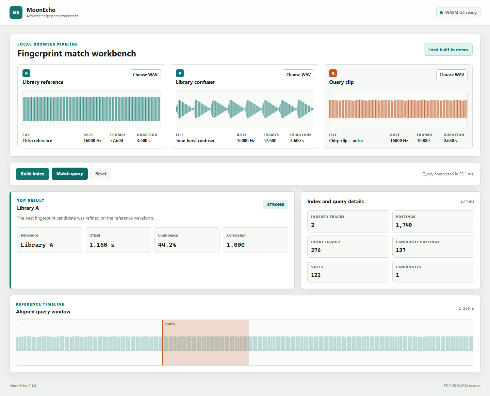

# MoonEcho

MoonEcho is a local-first acoustic fingerprint search and audio alignment toolkit written in MoonBit.

The project is in milestone `M5`: the core library, native CLI, benchmarks,
WASM browser workbench, and release materials are complete. Publication
commands and release checks are documented in [docs/release.md](docs/release.md).

## Status

- Project name: MoonEcho / 月响
- Version: 0.1.0
- Mooncakes.io: https://mooncakes.io/docs/#/lin2077-zeming/moonecho/
- Main language: MoonBit
- Target: native and WebAssembly
- License: Apache-2.0
- Audio input dependency: `Ridge-Lab/moonwavkit@0.1.3`
- Spectrum dependency: `chgttyyr/MoonSpectrum@0.2.2`

## Requirements

- MoonBit toolchain `0.10.14` or newer; CI is pinned to
  `0.10.14+7d59c7ec9`
- Node.js `22` or newer for the WASM browser demo and its smoke test

Install MoonBit from
[moonbitlang.com/download](https://www.moonbitlang.com/download/). The native
CLI does not require Node.js.

## Install

```bash
git clone https://github.com/lin2077-zeming/MoonEcho.git
cd MoonEcho
moon update
moon check --target all --deny-warn
moon test --target native --deny-warn
```

Use the published package in another MoonBit module:

```bash
moon add lin2077-zeming/moonecho@0.1.0
```

## Quick Start

```bash
moon check
moon test
moon run cmd/moonecho
moon run examples/basic
moon run examples/wav-adapter
moon run examples/spectrum
moon run examples/fingerprint
moon run examples/index
moon run examples/match
```

CLI:

```bash
moon run cmd/moonecho -- version
moon run cmd/moonecho -- index --input track.wav --output track.idx --name demo
moon run cmd/moonecho -- index --manifest tracks.tsv --output library.idx
moon run cmd/moonecho -- index --input clip.wav --output library.idx --id 2 --append
moon run cmd/moonecho -- match --index track.idx --input clip.wav
moon run cmd/moonecho -- info --index library.idx --json
moon run cmd/moonecho -- bench --json
```

WASM browser demo:

```bash
npm run build:demo
npm run serve:demo
```

Open `http://127.0.0.1:4173`, load the built-in chirp corpus, build the index,
and run the query. The demo requires WebAssembly GC support; see
[docs/wasm-demo.md](docs/wasm-demo.md).

Expected CLI output:

```text
MoonEcho (月响) v0.1.0: Local-first acoustic fingerprint search and audio alignment toolkit
```

## Minimal API

```moonbit nocheck
///|
fn main {
  println(status())
}
```

## Audio Adapter

MoonEcho intentionally reuses MoonWavKit for RIFF/WAVE parsing, PCM decoding,
generic PCM processing, and linear resampling. MoonEcho's adapter keeps a
stable local API for the fingerprint pipeline:

```moonbit nocheck
///|
fn inspect_wav(bytes : Array[Int]) -> Unit raise {
  let audio = @audio.load_wav_mono(bytes, target_sample_rate=16000)
  println(audio.frame_count())
}
```

## Spectrum Adapter

MoonSpectrum provides the FFT, STFT, and synthetic signal generators. MoonEcho
adapts them to normalized audio buffers and its own error boundary:

```moonbit nocheck
///|
let audio = @audio.load_wav_mono(bytes, target_sample_rate=16000)

///|
let config = @spectrum.SpectrumConfig::new(window_length=1024, hop_size=512)

///|
let result = @spectrum.spectrogram(audio, config)

///|
let peaks = @spectrum.extract_peaks(result, @spectrum.PeakConfig::new())
```

## Fingerprint v1

MoonEcho's fingerprint layer turns spectral peaks into pairwise hashes and
serializes them in a deterministic binary format:

```moonbit nocheck
///|
let config = @fingerprint.HashConfig::new()

///|
let fp = @fingerprint.fingerprint(
  peaks,
  config,
  frame_count=result.magnitudes.length(),
  bin_count=result.frequencies.length(),
)

///|
let encoded = @fingerprint.encode(fp)
```

The exact byte layout is documented in
[docs/fingerprint-v1.md](docs/fingerprint-v1.md).

## Index Snapshot v2

The index layer maps each fingerprint hash to track/frame/bin postings and
persists the full structure plus its preprocessing profile with a deterministic
binary snapshot:

```moonbit nocheck
let index = @index.FingerprintIndex::new(config)
index.add_track(1, "track-a", fingerprint)
let snapshot = @index.encode(index)
let restored = @index.decode(snapshot)
```

The exact byte layout is documented in [docs/index-v2.md](docs/index-v2.md).
Legacy v1 snapshots remain readable; see [docs/index-v1.md](docs/index-v1.md).

## Candidate Matching

The matching layer votes on `(track_id, offset)` pairs produced by shared
fingerprint hashes, then ranks tracks and computes confidence and margin:

```moonbit nocheck
let config = @match.MatchConfig::new(min_votes=3, min_confidence=0.2)
let result = @match.match_fingerprint(index, query, config)
println(@match.status_label(result.status))
```

The scoring algorithm is documented in [docs/matching.md](docs/matching.md).
Sample-accurate refinement is documented in [docs/alignment.md](docs/alignment.md).

## CLI

The command-line façade wires audio decoding, spectrum extraction, fingerprint
encoding, index snapshots, batch/append indexing, inspection, candidate
matching, and benchmarks into one executable:

```text
moonecho index   # single track, manifest, or append
moonecho match   # search and optional sample alignment
moonecho info    # inspect snapshot metadata and tracks
moonecho bench   # robustness and performance report
```

`index`, `match`, `info`, and `bench` support `--json` for automation.

See [docs/cli.md](docs/cli.md) for all options and reproducibility notes.

## Browser Demo

The WASM workbench is a genuine `wasm-gc` library boundary. JavaScript loads
WAV bytes through two small host functions; the MoonBit module performs the
fingerprint pipeline and sample alignment.

The page includes a deterministic self-contained corpus without bundled audio
assets. It can also accept three user WAV files: two library tracks and one
query clip.



The exact ABI and verification commands are documented in
[docs/wasm-demo.md](docs/wasm-demo.md).

The robustness and benchmark harness is documented in
[docs/benchmark.md](docs/benchmark.md).

Dependency licenses are listed in
[THIRD_PARTY_NOTICES.md](THIRD_PARTY_NOTICES.md). The Mooncakes.io release
checklist is in [docs/release.md](docs/release.md).

The final acceptance map is in [docs/acceptance.md](docs/acceptance.md), and
the version history is in [CHANGELOG.md](CHANGELOG.md).

## License

MoonEcho is released under the Apache-2.0 license. Third-party package notices
are recorded in [THIRD_PARTY_NOTICES.md](THIRD_PARTY_NOTICES.md).

## Design References

MoonEcho's landmark-style peak pairing and offset voting are based on the
published acoustic fingerprinting approach introduced by Avery Wang for
Shazam. The implementation is original MoonBit code.

The high-level algorithm was also informed by the open-source Dejavu project:
https://github.com/worldveil/dejavu. No Dejavu source code was copied or
translated. Dejavu is distributed under the MIT license.

## Roadmap

- M0: project skeleton, README, LICENSE, CI, tests, first runnable example.
- M1: WAV/PCM adapter over MoonWavKit, FFT/STFT adapter over MoonSpectrum, two-dimensional spectral peak extraction.
- M2: fingerprint encoding, inverted index, snapshot format.
- M3: matching, offset voting, confidence scoring, CLI.
- M4: robustness tests, benchmarks, WASM demo.
- M5: mooncakes.io release and final acceptance materials.

See [docs/任务规划书.md](docs/任务规划书.md) for the full plan.
